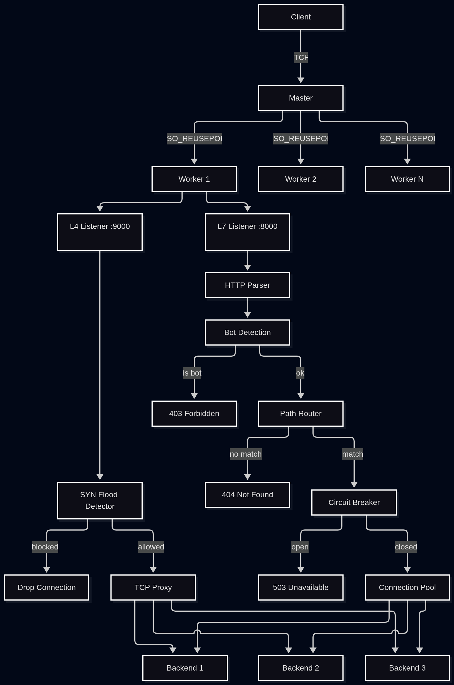

# Bifrost

An L4 + L7 load balancer built from scratch in Python using raw sockets and asyncio. It is a learning project, not yet production-ready (see Known issues below). Named after the Norse bridge between worlds.

Built as a deep-dive into networking internals — TCP, socket programming, Layer 4 vs Layer 7, connection pooling, circuit breakers — the kind of stuff that comes up in SRE interviews.

---

## What it does

### Layer 4
- Async TCP proxy with bidirectional forwarding
- Round robin, least connections, IP hash load balancing
- Per-IP connection limiter (named SYN flood detection in the code) — counts open connections per IP and blocks the IP temporarily if the threshold is exceeded. It runs in user space after the TCP handshake, so it is not kernel-level SYN flood protection
- SO_REUSEPORT — kernel distributes connections across workers

### Layer 7
- HTTP request parsing
- Path-based routing with per-route backend pools
- Bot detection — header fingerprinting and request cadence
- Per-backend connection pooling with TTL
- Circuit breaker per backend — closed / open / half-open states
- Kafdis integration point — deferred until Kafdis upgrade

---

## Architecture

```
Master Process
├── Spawns N workers (N = CPU cores)
├── Config reload on SIGHUP (validated first, workers restarted; in-flight connections are dropped)
├── Respawns crashed workers
└── Workers (SO_REUSEPORT — kernel distributes connections)
    ├── asyncio event loop
    ├── L4 listener (port 9000)
    │   ├── SYN flood detection
    │   └── TCP proxy → backend pool
    └── L7 listener (port 8000)
        ├── HTTP parser
        ├── Bot detection
        ├── Path-based routing
        ├── Circuit breaker
        └── Connection pool → backend pool
```

### Key design decisions

| Decision | Reasoning |
|---|---|
| asyncio event loop | Non-blocking I/O — one thread handles thousands of connections |
| Multiprocess + SO_REUSEPORT | One worker per CPU core, kernel distributes connections |
| Port-based L4/L7 split | TCP headers don't reveal HTTP — operator picks which port gets which layer |
| SYN flood detection in-process | Redis adds a network hop — too slow at L4 packet rates |
| Connection pooling at L7 only | L4 can't tell where one request ends |
| Circuit breaker | Prevents retry amplification from cascading into cluster-wide failure |
| Bot detection: headers + cadence | Connection timing is too tight for programmatic clients |

---



## Project Structure

```
Bifrost/
├── master.py               # entry point: worker lifecycle, config reload, respawn
├── worker.py               # asyncio event loop per core
├── config.py               # YAML config parsing
├── backend.py              # test backend server
├── core/
│   ├── L4/
│   │   ├── proxy.py        # async TCP proxy, bidirectional forwarding
│   │   ├── algorithms.py   # round robin, least connections, IP hash
│   │   └── syn_flood.py    # half-open connection tracking
│   └── L7/
│       ├── proxy.py        # HTTP proxy, routing, circuit breaker
│       ├── parser.py       # HTTP request parser
│       ├── algorithms.py   # path-based routing
│       ├── bot_detection.py
│       └── kafdis.py       # Kafdis integration (deferred)
├── pool/
│   ├── connection_pool.py  # connection pooling with TTL
│   └── health.py           # active probing, circuit breaker
├── docker/
│   ├── proxy/Dockerfile
│   └── backend/Dockerfile
├── bench/
│   ├── benchmark.js        # k6 load test script
│   ├── nginx.conf
│   └── haproxy.cfg
└── docker-compose.yml
```

---

## Running locally

### With Docker (recommended)

```bash
docker compose up --build
```

```bash
# L7 test
curl http://127.0.0.1:8000/api/users

# L4 test
nc 127.0.0.1 9000
```

### Without Docker

```bash
# Start test backends
python backend.py backend1 9001
python backend.py backend2 9002

# Start the proxy
python master.py
```

### Config reload

```bash
kill -HUP <master_pid>
```

The new config is validated first; if it is invalid the old config is kept. Valid configs restart all workers, so in-flight connections are dropped.

---

## Configuration

`config.yaml` is mounted as a volume — edit it and send SIGHUP to reload without rebuilding.

```yaml
listen_port: 9000        # L4 port
l7_port: 8000            # L7 port
algorithm: round_robin   # round_robin | least_connections | ip_hash
max_pool_size: 100       # idle connections kept per backend per worker
bot_detection: false     # header fingerprinting + cadence check

backends:
  - host: backend1
    port: 9000
  - host: backend2
    port: 9000
  - host: backend3
    port: 9000

syn_flood_threshold: 10
syn_flood_block_duration: 6   # seconds

routes:
  - path: /api/users
    backends:
      - host: backend1
        port: 9000
      - host: backend2
        port: 9000
  - path: /api/payments
    backends:
      - host: backend3
        port: 9000
```

---

## Benchmarks

Tested with k6 — ramping arrival rate from 500 to 4000 iterations/s against Bifrost, Nginx, and HAProxy. All three proxying to the same 3 backends on the same machine.

| Metric | Bifrost | HAProxy |
|---|---|---|
| Req/sec | 2249 | 2249 |
| avg latency | 792µs | 328µs |
| p95 latency | 1.26ms | 0.495ms |
| max latency | 25ms | 21ms |
| Error rate | 0% | 0% |

Nginx was excluded from the final comparison — it hit worker/connection limits under load that skewed results. Tuning it properly is a separate exercise.

Throughput is identical because k6 uses an arrival-rate executor: both proxies were offered the same fixed request rate and neither dropped requests, so Req/sec only shows that the offered load was served, not a throughput limit. Latency is the meaningful comparison. HAProxy ran with its default settings (TCP mode, no HTTP parsing), so it is not a like-for-like HTTP comparison.

HAProxy is ~2.4x faster on average latency. The gap is Python HTTP parsing overhead on every request — HAProxy is C with no per-request parsing at this level. For an I/O bound proxy in Python, asyncio closes most of the gap that the language would otherwise create.

One real bug found and fixed during benchmarking: `max_pool_size=10` caused pool exhaustion under load, forcing new TCP handshakes on every overflow request. Increasing it to 50 dropped p95 from 24ms to 1.26ms (`config.yaml` now uses 100).

---

## Known issues / planned work

Fixed from the code review: route-prefix lookup (`/api/users/1` works), response read by `Content-Length`, pool TTL and stale-connection checks, validated config reload, per-IP counter released on disconnect, L7 `least_connections` counters, no 502s from re-pooling closed connections.

Still open — in priority order:

- No timeouts anywhere — a hung backend or slow client ties up connections forever
- `HealthChecker` is never started — no active health checking at runtime; no failover to another backend when one fails
- HTTP parser crashes on binary bodies and malformed request lines, and header names are case-sensitive (bot detection can reject lowercase headers)
- Request is read with a single `read(4096)` — large or split requests and chunked bodies are not handled
- Backend 5xx responses do not count as circuit breaker failures
- Reload restarts workers abruptly instead of draining connections
- L4 proxy does not support TCP half-close
- Round robin, circuit breaker, pool and rate-limit state are per worker process, not shared
- No tests or CI

